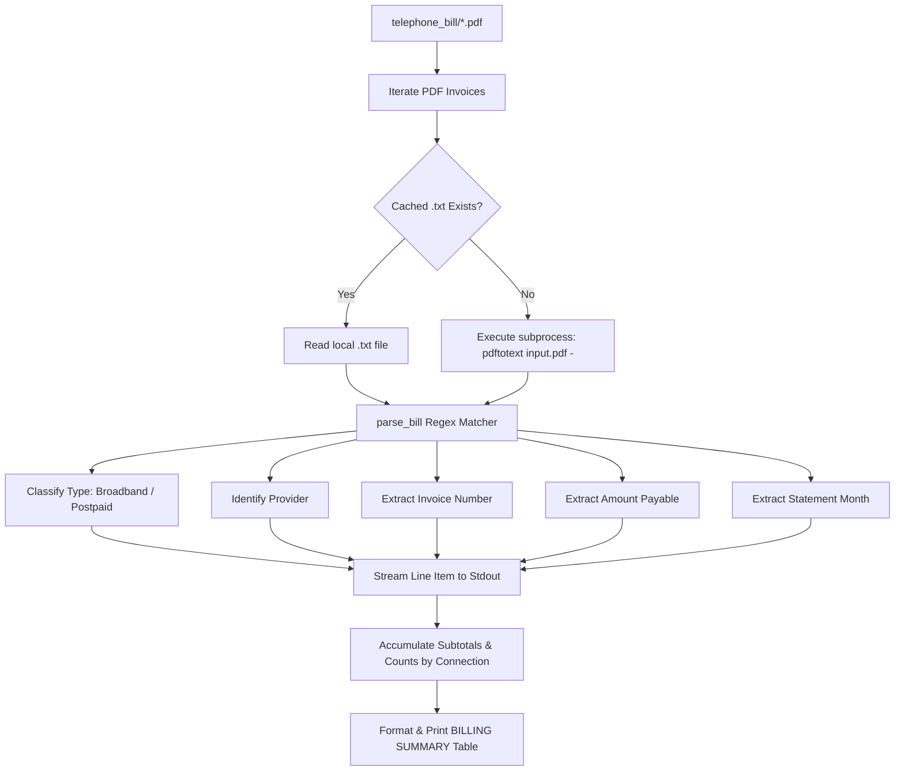

# Test Parser & Bill Calculation Tool (`test_calculate_bill.sh` / `test_parser.py`)

A standalone, read-only diagnostic utility designed to validate PDF invoice parsing, inspect connection subtotals, and calculate total reimbursement amounts prior to generating claim forms.

---

## 1. Overview

Before running the full claim generation tool ([`make_bill.py`](../make_bill.py)) or batch printing ([`print_bills.py`](../print_bills.py)), [`test_calculate_bill.sh`](../test_calculate_bill.sh) allows you to verify that all bills in [`telephone_bill/`](../telephone_bill/) are correctly read, display line items, and aggregate reimbursement totals.

### Key Capabilities:
- **Zero Side Effects**: Read-only diagnostic script. It does not modify form templates, write claim forms, or send jobs to print servers.
- **Config-Independent**: Does not require `config.cfg` or employee details to be set up.
- **Connection Subtotals & Grand Total**: Logs per-connection breakdown (`Postpaid` vs. `Broadband`) and overall total reimbursement amount.
- **Multi-Vendor Verification**: Extracts vendor names, invoice numbers, amounts, bill categories, and billing months across multiple telecom providers (Airtel, Jio, BSNL, Vodafone/Vi, MTNL, etc.).
- **Immediate Feedback**: Outputs structured telemetry directly to the console.

---

## 2. Prerequisites

1. **Poppler Utilities**: The parser utilizes `pdftotext` to extract raw text content from PDF invoices.
   ```bash
   # Debian / Ubuntu / Mint
   sudo apt install poppler-utils
   ```
2. **Virtual Environment**: Automatically created and maintained by the wrapper script if not already present.

---

## 3. How to Use

### Step 1: Place Your Invoices
Drop your downloaded digital PDF invoices into the blank [`telephone_bill/`](../telephone_bill/) directory.

### Step 2: Run the Diagnostic & Calculation Tool
Execute the runner script:

```bash
./test_calculate_bill.sh
```

The script automatically ensures `.venv` dependencies are loaded and invokes [`test_parser.py`](../test_parser.py) to stream parsed invoice items, per-connection subtotals, and the grand total to standard output.

---

## 4. Sample Output & Field Breakdown

When executed, the tool outputs structured itemized lines for every invoice scanned, followed by an aggregated financial summary grouped by connection type:

```text
1-5031491371630_415336010_8_2026.pdf: Type=Postpaid, Month=Jul, Provider=AIRTEL, Invoice=MF2707I005670638, Amount=1414.82
1-5031491371630_652606311_9_2026.pdf: Type=Postpaid, Month=Aug, Provider=AIRTEL, Invoice=MF2707I007036433, Amount=1414.82
1-5031491371630_891902297_10_2026.pdf: Type=Postpaid, Month=Sep, Provider=AIRTEL, Invoice=MF2707I008401139, Amount=1414.82
20012268137_437367900_8_2026.pdf: Type=Broadband, Month=Jul, Provider=AIRTEL, Invoice=HF2707I005513161, Amount=942.82
20012268137_682185166_9_2026.pdf: Type=Broadband, Month=Aug, Provider=AIRTEL, Invoice=HF2707I006913737, Amount=942.82
20012268137_937941798_10_2026.pdf: Type=Broadband, Month=Sep, Provider=AIRTEL, Invoice=HF2707I008341140, Amount=942.82

=======================================================
                 BILLING SUMMARY
=======================================================
  Broadband       : ₹  2,828.46  (3 bills)
  Postpaid        : ₹  4,244.46  (3 bills)
-------------------------------------------------------
  Grand Total     : ₹  7,072.92  (6 bills)
=======================================================
```

### Extracted Metadata Fields:

| Field | Description | Detection Logic |
| :--- | :--- | :--- |
| **`Type`** | `Broadband` or `Postpaid` | Scans filename and text for keywords (`wifi`, `broadband`, `mobile`, `postpaid`). |
| **`Month`** | Billing Month (`Jul`, `Aug`, etc.) | Parses `Statement Period`, date headers (`DD/MM/YY`), or filename hints. |
| **`Provider`** | Telecom operator name | Identifies keywords: `AIRTEL`, `JIO`, `BSNL`, `VI`, `MTNL`. |
| **`Invoice`** | Unique invoice/bill number | Matches standard invoice regex patterns (e.g. `MF...`, `HF...`, or `Bill NO`). |
| **`Amount`** | Payable billed amount (₹) | Matches `Amount Payable`, `Total Amount`, or decimal currency tokens. |

---

## 5. Architectural Pipeline



---

## 6. Comparison: `test_parser.py` vs `make_bill.py`

| Capability | [`test_parser.py`](../test_parser.py) | [`make_bill.py`](../make_bill.py) |
| :--- | :--- | :--- |
| **Primary Scope** | Fast, non-destructive parsing diagnostics | Production claim form population |
| **Modifies Disk** | **No** (Zero writes) | **Yes** (Generates `filled_claim_[Quarter].pdf`) |
| **Requires `config.cfg`** | **No** | **Yes** (Validates LAN ID, bank account, staff no) |
| **Quarter Detection** | **No** | **Yes** (Aggregates months to select Q1–Q4) |
| **Form Formatting** | **No** | **Yes** (AcroForm population, Helvetica resizing) |
| **Visual Overlays** | **No** | **Yes** (ReportLab diagonal strike-through on Box 2) |

---

## 7. Troubleshooting

> [!WARNING]
> If any field displays as `None` or an unexpected value in `test_parser.py`:

- **`Invoice=None`**: Ensure the invoice PDF contains selectable text (not a scanned image without OCR). If the provider uses a unique header label, check regex patterns in `test_parser.py` and `make_bill.py`.
- **`Month=None`**: Verify that the statement period date format is present in the document or include the 3-letter month abbreviation (e.g., `jul`, `aug`) in the filename.
- **`Type=Postpaid` (when expecting Broadband)**: Ensure the filename contains `broadband`, `broad_band`, or `wifi`.
