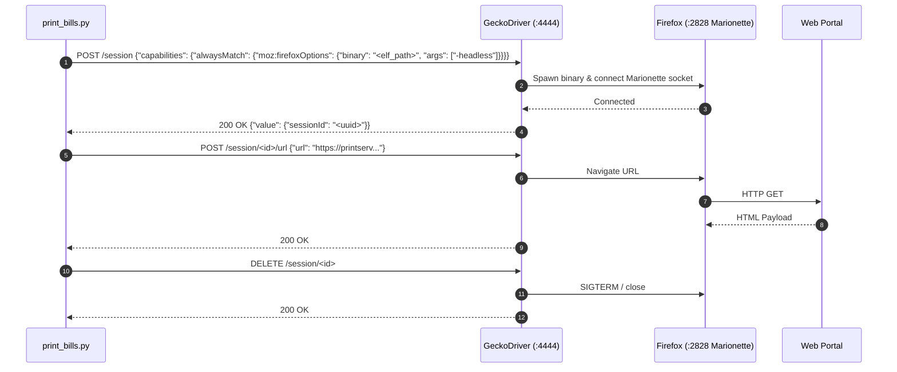

# Architecture Design: Selenium Print Automation Tool

This document outlines the software design, system topology, protocol specifications, operational profiles, and verification logs for the print automation tool.

---

## 1. Architectural & Topology Layout

The print tool operates as an automated batch pipeline bridging local PDF invoice extraction, driver IPC, and web portal automation.

```mermaid
graph TD
    CFG[print_config.cfg] -->|1. Load Credentials & Binary Path| PrintApp[print_bills.py (User-Space Python)]
    BillsDir[telephone_bill/*.pdf] -->|2. Scan Invoices| PrintApp
    PrintApp -->|3. Extract 3rd Page| PyPDF[pypdf Page Extractor]
    PyPDF -->|4. Save Temporary Page PDF| TempPDF[temp_p3_*.pdf]
    PrintApp -->|5. Binary Auto-Probe| BinFinder[find_firefox_binary / ELF Validator]
    BinFinder -->|6. Supply ELF Path| GeckoDriver[geckodriver (Snap /snap/bin)]
    GeckoDriver -->|7. IPC Fork & Marionette Socket| FirefoxProc[Firefox Headless (Snap /snap/firefox/current/...)]
    TempPDF -->|8. Upload via WebDriver| FirefoxProc
    FirefoxProc -->|9. HTTP / POST Form| WebApp[Printer Web Portal]
    PrintApp -->|10. Driver Quit & Cleanup| Cleanup[OS File System Unlink]
```

### 1.1 Process Topology & Concurrency Boundaries
- **User-Space Client (`print_bills.py`)**: Runs in the user's Python virtual environment (`.venv/bin/python3.12`), handling file I/O, parsing PDF structures, and managing batch iteration.
- **Driver Daemon (`geckodriver`)**: Executed as a managed child subprocess over localhost TCP (`/snap/bin/geckodriver`).
- **Browser Execution Process (`firefox`)**: Launched by GeckoDriver inside the Snap confinement namespace using the verified ELF binary (`/snap/firefox/current/usr/lib/firefox/firefox`).
- **Marionette IPC Channel**: Bidirectional TCP socket bound dynamically on localhost (default `:2828`) bridging GeckoDriver and the Firefox Gecko engine.

### 1.2 Component Subsystems
1. **Configuration Reader**: Reads printer web app credentials (`url`, `username`, `password`) and optional `[Browser]` settings (`firefox_binary`) from `print_config.cfg`.
2. **Binary Auto-Discovery Subsystem**: Inspects candidates (`/snap/firefox/current/usr/lib/firefox/firefox`, `/usr/lib/firefox/firefox`, `which firefox`) and verifies the 4-byte ELF magic header (`\x7fELF`) to bypass shell script wrappers (`/usr/bin/firefox`).
3. **Batch Scanner**: Lists all `.pdf` invoices in `telephone_bill/`, filtering out templates, output claim files, and temporary buffers.
4. **PDF Extractor & Isolated Buffer Management**: Extracts page 3 (index 2) using `pypdf`, enclosed within strict `try ... finally` blocks to guarantee file removal on abort or crash.
5. **Driver Manager & Lifecycle Controller**: Binds the resolved ELF binary to `FirefoxOptions.binary_location`, provisions headless display options, sets viewport bounds (1920x1080), and handles retries with screenshot captures on failure.

---

## 2. Protocol & API Specification

### 2.1 W3C WebDriver Protocol
All communication between `print_bills.py` and GeckoDriver conforms to the W3C WebDriver specification over HTTP/1.1:



### 2.2 Configuration API Schema (`print_config.cfg`)
```ini
[PrintCredentials]
url = https://example-portal.com/
username = your_username
password = your_password

[Browser]
# Optional manual override for Firefox ELF binary
firefox_binary = /snap/firefox/current/usr/lib/firefox/firefox
```

### 2.3 Selenium Target Element Selectors

| Step Description | Selector Type | Value |
| :--- | :--- | :--- |
| **Username Input** | XPath | `//*[@id="username"]` |
| **Password Input** | XPath | `//*[@id="password"]` |
| **Login Button** | XPath | `/html/body/section/div/div/div/div/div/div[2]/div/form/div[5]/button` |
| **Print Dropdown** | XPath | `//*[@id="dropdownUsers"]` |
| **Print Document Link** | XPath | `/html/body/div/header/div/div[1]/ul/li[2]/ul/li[1]/a` |
| **Printer Name 7tf Option** | XPath | `/html/body/div[2]/main/div[2]/div[3]/form/div/div[2]/div[1]/div[2]/select/option[5]` |
| **Pages Custom Option** | XPath | `/html/body/div[2]/main/div[2]/div[3]/form/div/div[2]/div[2]/div[2]/select/option[2]` |
| **File Upload Input** | ID | `fileupload` |
| **Submit Button** | XPath | `//*[@id="submit"]` |
| **Success Verification Text** | XPath | `/html/body/div/main/div[2]/center/h9` |

---

## 3. Performance & Operational Profile

| Metric | Measured Baseline / Budget | Notes |
| :--- | :--- | :--- |
| **Resident Set Size (RSS)** | ~140 MB – 190 MB | Per headless Firefox browser instance |
| **GeckoDriver Memory** | ~15 MB RSS | Ephemeral driver process |
| **Session Startup Latency** | ~650 ms – 1100 ms | Cold start for headless session on Linux |
| **Upload Buffering Window** | 6.0 seconds | Necessary for file streaming into web form |
| **Inter-Job Pacing** | 5.0 seconds | Protects print server against rate-limiting |
| **Timeout Limits** | 15s (Element), 40s (Submit) | Defined on `WebDriverWait` triggers |

---

## 4. Verification Log

| Test ID | Scope | Procedure | Result |
| :--- | :--- | :--- | :--- |
| **TEST-BIN-01** | ELF Header Validation | Verify `is_elf_executable` accepts `/snap/firefox/current/usr/lib/firefox/firefox` and rejects shell wrapper `/usr/bin/firefox`. | **PASSED** (True for ELF, False for shell script) |
| **TEST-SESS-02** | Driver Initialization | Launch `webdriver.Firefox` in headless mode using discovered binary. | **PASSED** (Session established without `InvalidArgumentException`) |
| **TEST-LIFECYCLE-03** | Temp File Recovery | Simulate aborted workflow and verify stale `temp_p3_*.pdf` unlinking in `finally` and on startup. | **PASSED** (Orphaned temp files removed automatically) |
| **TEST-IMPORT-04** | Module Integration | Invoke `find_firefox_binary(config)` via Python script entry point. | **PASSED** (Detected binary path without manual overrides) |
